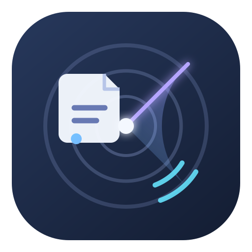

# 消息雷达

<p align="center">
  
</p>

**跟踪公开通知，把原文、变化和待办整理在一处。**

消息雷达是面向 DeepSeek Harness（DSH）的通知跟踪插件。设置关注后，它会发现并保存公开通知；Agent 可以据原文整理适用对象、待办事项、材料、时间、办理渠道和证据，也可以把相关通知串成事件并安排回查。

## 主要模块

| 模块 | 能做什么 |
|---|---|
| **关注设置** | 按主题、适用对象、关键词和来源设置关注，安排新通知发现与旧通知回查。 |
| **正式消息** | 查看已整理的通知、原文依据和版本变化。 |
| **待整理** | 查看待处理通知和进度，继续处理失败或中断内容，也可管理暂不纳入的通知。 |
| **关注事件** | 关联相关通知，查看时间线和要求；不同通知间的冲突要求并列呈现，便于复核。 |
| **运行状态** | 查看发现、采集与整理任务的进度，对可恢复的运行重试或取消。 |
| **本机服务** | 查看并管理 Radar 的本机服务。 |

## 怎么使用

- **在对话里：**告诉 Agent 要关注什么、整理哪些通知、回查哪条旧通知，或把哪些通知归到一个事件。
- **在“消息雷达”页面里：**查看正式消息、待整理、关注事件、关注设置和运行状态。
- **接入公开网站：**告诉 Agent 网站地址和关注范围；根据站点结构准备并验证来源适配器，再用于关注。

Agent 整理通知时保留原文依据；不确定、未读或无法核验的内容应明确标出。事件视图帮助比较通知中的要求，不代表个人事项已完成。需要变更为人工规则时，由用户在页面确认提案。

## 安装

在 DSH 的「插件 → 添加插件 → 包名或地址」中输入 [GitHub Release 包](https://github.com/chanhaoxian5-ship-it/dsh-radar/releases/download/v0.1.0-alpha.9/chanhaoxian5-dsh-radar-0.1.0-alpha.9.tgz)。也可用固定标签的源码地址：

```text
github:chanhaoxian5-ship-it/dsh-radar#v0.1.0-alpha.9
```

安装后配置独立的 Python 运行时路径 `pythonPath` 和数据目录 `dataDir`，并安装 [`requirements.txt`](requirements.txt) 中的 Python 依赖。详细步骤见[安装与升级说明](docs/install.md)。

## 数据与权限

- 通知正文、附件和后续版本保存在 Radar 的独立数据目录中，整理结果引用对应的原文与资源版本。
- Agent 按用户授权的来源和订阅操作；人工规则由用户确认后生效。
- Radar 不代替用户完成通知事项，也不自动修改项目计划。

## 开发与检查

```powershell
$env:PYTHONUTF8='1'
python -m pip install -r requirements.txt
python -m unittest discover -s tests -v
npm ci --ignore-scripts --no-audit --no-fund
node --test tests/controller.test.mjs tests/controller-lifecycle.test.mjs
```

Agent 的操作规则见 [Radar Skill](skills/radar/SKILL.md)；请求契约见 [`docs/api`](docs/api/) 和[验收范围](docs/verification.md)。
